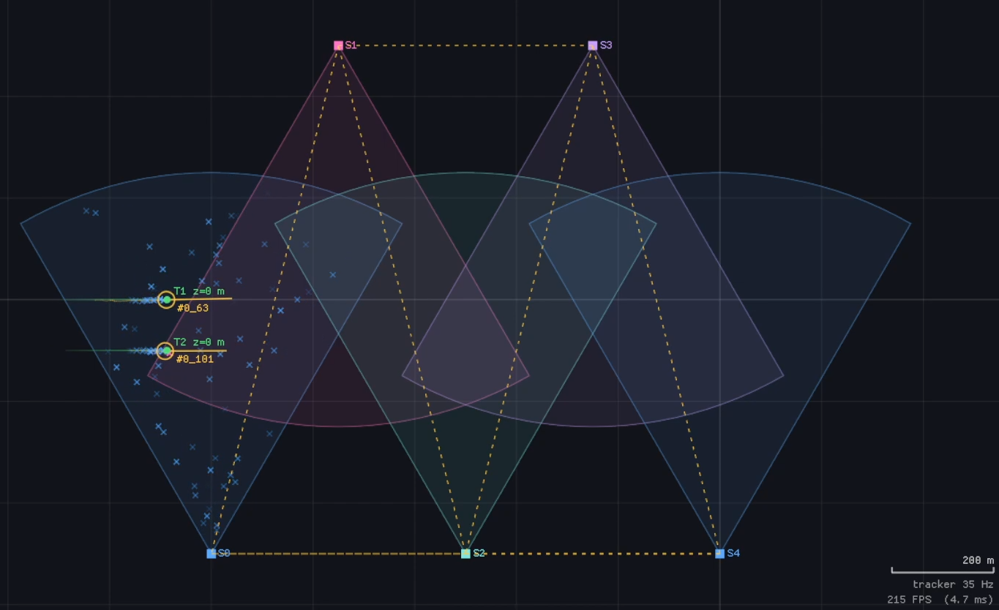
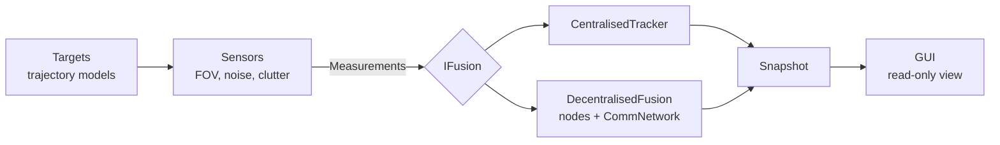

# Multi-Target Tracking Playground

[](https://en.cppreference.com/w/cpp/20)
[](https://cmake.org/)

A C++20 / Dear ImGui sandbox for learning **multi-sensor, multi-target tracking**, with a focus on comparing **centralised** and **decentralised** fusion architectures on identical data.

Truth, sensors and trackers all live in **3D**; the viewer is a **2D top-down** projection (altitude is shown as icon size and in labels). Everything is driven by small YAML scenario files and tweakable live from the GUI.

> **This is a learning project, not production code. Watch a video demonstration by clicking below**

<p align="center">
  <a href="https://youtu.be/OkfwXB6NlO8">
    
  </a>
</p>

---

## Features

**Simulation**
- Targets with a pluggable trajectory model: constant velocity and coordinated turn (turn rate about +z, constant vertical speed). Targets can be born and die at set times.
- Sensors with a full 3D pose (position + quaternion; boresight is +x in the sensor frame), cone field of view, min/max range, scan rate, detection probability, Poisson clutter, constant bias and per-axis Gaussian noise.
- Two measurement types, selected per sensor: `cartesian` (x, y, z in the sensor frame) and `range_az_el` (range, azimuth, elevation).
- Seeded RNG, so a given scenario is exactly reproducible. Switching architecture in the GUI resets with the same seed, so both modes see **identical truth and measurements**.

**Tracking**
- 6-state constant-velocity **Extended Kalman Filter** `[x y z vx vy vz]`, Joseph-form covariance update.
- Greedy global nearest-neighbour association with chi-squared gating.
- Multiple sensors can update the same track in one scan (a per-track bitmask stops one sensor updating a track twice).
- Track lifecycle: tentative -> confirmed after N hits, deleted after M misses (separate miss limit for tentatives), plus duplicate-track pruning.

**Decentralised fusion**
- One node per sensor, each running its own tracker.
- Simulated comms network: latency, packet drop, broadcast period, link range, and packet buffering.
- Track-to-track fusion using **covariance intersection** (safe when cross-correlations are unknown).
- **Priors**: a neighbour's confirmed track is used as a cue for this node's own sensor. A node only adopts the track as its own after enough independent hits from its own measurements.

**GUI** (SDL2 + OpenGL3 + Dear ImGui, docking layout)
- Pan / zoom / camera-follow, grid, scale bar, sensor FOV sectors, trails, measurement blips that fade with age, 2-sigma covariance ellipses.
- Live sliders for sensor parameters, tracker parameters and comms settings.
- Scenario browser (`Ctrl+O`), reload (`Ctrl+R`), pause (`Space`), seed + reset.
- Telemetry table and a rolling per-target position-error plot.
- In decentralised mode: view all nodes, or a single node (showing its unfused local tracks and the link to its fused estimate), plus comm-link overlay.

<!-- ---

## Architecture

The code is split into layers so the maths can run without any rendering.



| Layer | Directory | Responsibility |
|---|---|---|
| A. Core + sensors | `src/core`, `src/sensors` | Types, targets, sensors, measurement models |
| B. Tracking | `src/tracking` | EKF, centralised tracker, decentralised fusion, `IFusion` interface |
| C. Simulation | `src/sim` | Clock and execution order, comms network, scenario loading, `Snapshot` |
| D. View | `app/main_gui.cpp`, `src/view` | ImGui front end; reads `Simulation::snapshot()` only |

`sfsim_core` (layers A-C) has no rendering dependencies, so it is usable headless and testable. -->

### Project structure

```text
sensor_fusion_playground/
├── CMakeLists.txt
├── Doxyfile                       # doxygen Doxyfile -> docs/html
├── app/
│   ├── main_gui.cpp               # SDL2 + OpenGL3 + Dear ImGui front end
│   └── main_headless.cpp          # runs a scenario, prints a summary
├── scenarios/                     # YAML scenario files
│   ├── default.yaml               # 3 range/az/el sensors, 4 targets, decentralised
│   ├── cartesian_clutter.yaml     # Cartesian sensor pair, heavy clutter
│   └── corridor.yaml              # line of short-range sensors, 2 targets
├── src/
│   ├── core/                      # Types, Target + trajectory models, maths helpers, RateCounter
│   ├── sensors/                   # Sensor, Measurement, MeasurementModel
│   ├── tracking/                  # EKF, CentralisedTracker, Decentralised, IFusion, TrackerParams
│   ├── sim/                       # Simulation, Scenario(+Loader), CommNetwork, Snapshot
│   └── view/                      # Viewport (world <-> screen)
└── test/                          # measurement-model tests (see Status)
```

---

## Getting started

### Prerequisites

- A C++20 compiler (GCC 10+, Clang 11+, MSVC 2019+) and CMake 3.16+
- **SDL2** and **OpenGL** development packages (only needed for the GUI)
  - Ubuntu/Debian: `sudo apt install libsdl2-dev`
  - macOS: `brew install sdl2`
- Eigen, yaml-cpp and Dear ImGui (`docking` branch) are used from the system if found; otherwise CMake downloads them automatically (this needs network access on the first configure).

### Build

```bash
git clone <your-repo-url>
cd sensor_fusion_playground
cmake -S . -B build -DCMAKE_BUILD_TYPE=Release
cmake --build build -j
```

Headless only (no SDL2/ImGui needed):

```bash
cmake -S . -B build -DSFSIM_GUI=OFF
```

### Run

```bash
./build/sfsim_gui                          # loads scenarios/default.yaml
./build/sfsim_gui scenarios/corridor.yaml  # or pick a scenario
./build/sfsim_headless [scenario.yaml]     # 30 s of sim time, summary every 50 steps
```

### Controls

| Input | Action |
|---|---|
| Mouse wheel | Zoom about the cursor |
| Left / middle drag | Pan (disabled while following a target) |
| `Space` | Pause / resume |
| `Ctrl+O` / `Ctrl+R` | Open scenario / reload current scenario |

### Reading the display

| Element | Meaning |
|---|---|
| Green filled circle | Ground truth target (size grows with altitude) |
| Coloured cross | Measurement, fading with age (colour = sensor) |
| Amber circle + velocity line | Confirmed track |
| Red circle | Fused track (decentralised) |
| Grey circle | Tentative track (toggle "tentative") |
| Ellipse | 2-sigma position covariance |
| Dashed lines | Comm links, and fusion links between a fused track and its sources |
| Blue square (single-node view) | A node's local track before fusion, labelled `L#node_id` |

---

## Scenario files

Scenarios are YAML. Unknown keys are rejected with a line number, so a typo such as `p_detct` fails loudly instead of silently using the default. **Angles in the file are in degrees**; the loader converts to radians.

```yaml
name: "My scenario"
sim: {dt: 0.02, seed: 1}
fusion: decentralised            # or: centralised (the GUI checkbox can override)
comms: {enabled: true, latency_s: 0.1, drop_prob: 0.05, period_s: 0.5, range_m: 7500}
tracker: {q_accel: 80, gate_chi2: 11.34, confirm_hits: 25}

sensors:   # ids are assigned from list order: S0, S1, ...
  - {type: range_az_el, position: [-3000, -2000, 30], yaw_deg: 34.4,
     fov_half_angle_deg: 54.4, max_range: 7500, update_rate_hz: 5,
     sigma: [1, 0.573, 0.573]}          # [m, deg, deg] for range_az_el

targets:
  - {id: 1, position: [-1500, -500, 0], velocity: [70, 15, 0]}
  - {id: 2, position: [1500, 1500, 0], velocity: [-60, -10, 0],
     trajectory: {type: coordinated_turn, turn_rate_deg_s: 2.292}}
```

| Block | Keys (defaults in brackets) |
|---|---|
| `sim` | `dt` (0.1 s), `seed` (1) |
| `fusion` | `centralised` (default) or `decentralised` |
| `comms` | `enabled` (true), `latency_s` (0.1), `drop_prob` (0.05), `period_s` (0.5), `range_m` (10000) |
| `tracker` | `q_accel` (80), `gate_chi2` (11.34), `confirm_hits` (10), `delete_misses` (10), `delete_misses_tentative` (2), `init_vel_sigma` (100), `stale_after_s` (3), `track_gate_chi2` (16.81), `prior_confirm_hits` (5), `prior_reset_misses` (5) |
| `sensors[]` | `type` and `position` and `sigma` are **required**. Optional: `enabled` (true), `yaw_deg`/`pitch_deg`/`roll_deg` (0), `fov_half_angle_deg` (about 28.6), `min_range` (1), `max_range` (10000), `update_rate_hz` (5), `bias` (0), `p_detect` (0.9), `clutter_rate` (5 per scan) |
| `targets[]` | `id` and `position` required. Optional: `velocity` (0), `birth_time` (0), `death_time` (never), `trajectory` (`constant_velocity`, or `coordinated_turn` with `turn_rate_deg_s`) |

Conventions: yaw is about +z (0 deg = +x); a positive pitch tips the boresight **down**; a positive turn rate is counter-clockwise seen from above. `sigma` is mandatory because a default of 5 would mean 5 *radians* of azimuth noise on a `range_az_el` sensor.

---

## How it works

### One simulation step

1. Advance every living target with its trajectory model.
2. Each sensor that is due scans: it keeps targets inside its FOV, applies `p_detect`, converts truth to the sensor's measurement space, adds bias and noise, and adds Poisson clutter.
3. The measurements go to the active `IFusion` (centralised or decentralised).
4. A `Snapshot` (truth, measurements, tracks, unfused tracks) is published for the view.

### Measurement models

Each sensor owns a `MeasurementModel`, which picks a set of function pointers once at construction based on the sensor's `MeasType`. Callers just use `Meas2World`, `World2Meas`, the two Jacobians and `Residual`, and never branch on the measurement type. Adding a new measurement type means writing five functions, adding an enum value and adding one row to the library table in `MeasurementModel.cpp`.

For `range_az_el`, with the target at `(x, y, z)` in the sensor frame:

$$
z = \begin{bmatrix} r \\ \text{az} \\ \text{el} \end{bmatrix} =
\begin{bmatrix} \sqrt{x^2+y^2+z^2} \\ \operatorname{atan2}(y, x) \\ \operatorname{atan2}\left(z, \sqrt{x^2+y^2}\right) \end{bmatrix}
$$

The EKF uses `H = dh/dx`, where the position block is the model's Jacobian rotated into the world frame and the velocity block is zero (no sensor observes velocity). Azimuth residuals are wrapped to `[-pi, pi]`.

### Estimation

Constant-velocity prediction with a discrete white-noise-acceleration process model:

$$
F = \begin{bmatrix} I & \Delta t\, I \\ 0 & I \end{bmatrix}, \qquad
Q = q \begin{bmatrix} \tfrac{\Delta t^4}{4} I & \tfrac{\Delta t^3}{2} I \\ \tfrac{\Delta t^3}{2} I & \Delta t^2 I \end{bmatrix}
$$

Gating uses the squared Mahalanobis distance of the innovation, `d^2 = y^T S^-1 y` with `S = H P H^T + R`, compared against a chi-squared threshold (3 degrees of freedom; 99% = 11.34).

### Centralised tracking

All sensors feed one track pool. A scan is a pipeline of phases, each taking measurements by value and returning the ones it did not claim:

```
beginScan -> associateConfirmed -> associateTentative -> spawnTentatives -> endScan
```

New tracks are initialised from the first measurement, with the position covariance obtained by pushing `R` through the measurement-to-world Jacobian.

### Decentralised tracking

Each sensor is a node with its own `CentralisedTracker`. Per tick:

1. Every node predicts and associates against its own confirmed tracks.
2. Link topology is updated from node positions and the comm range.
3. Nodes broadcast their confirmed tracks every `period_s`; the network applies drop and latency.
4. Each node keeps the newest packet per peer.
5. Each node updates its priors from neighbours, then associates leftover measurements: priors first, then tentatives, then spawns new tentatives from whatever remains.
6. Each node builds its fused view: its own confirmed tracks are fused with fresh neighbour tracks via covariance intersection.

Covariance intersection fuses two estimates without knowing their cross-correlation:

$$
P^{-1} = \omega P_a^{-1} + (1-\omega) P_b^{-1}, \qquad
x = P\left(\omega P_a^{-1} x_a + (1-\omega) P_b^{-1} x_b\right)
$$

with `omega` chosen from a 21-point grid to minimise `trace(P)`.

<!-- ---

## Status and known limitations

- Association is **greedy nearest-neighbour**, both for measurement-to-track and track-to-track. It can swap or split tracks when targets are close.
- Track-to-track gating treats the two estimates' errors as independent. That is fine for deciding *whether* to fuse, but not exact.
- One sensor per decentralised node and sensor id must equal its index in the scenario (at most 64 sensors).
- The EKF assumes constant velocity, so manoeuvring targets rely on process noise (`q_accel`) to stay tracked. -->

---

## Documentation

API docs can be generated with Doxygen (call and caller graphs need Graphviz):

```bash
doxygen Doxyfile      # output in docs/html
```

## Profiling

A `Profile` build configuration adds `-O2 -g -pg` for `gprof`:

```bash
cmake -S . -B build-profile -DCMAKE_BUILD_TYPE=Profile
```

## License

Distributed under the MIT License. See [LICENSE](LICENSE) for details.